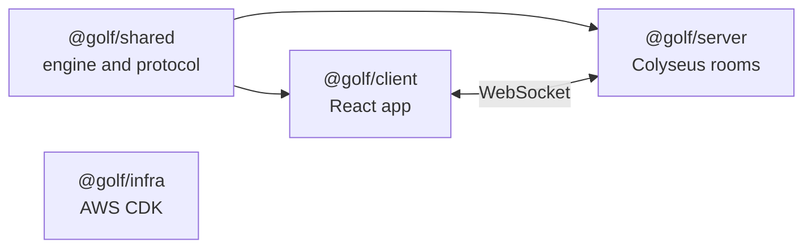

# Architecture

How the game is put together, and why. For the rules of the game itself see [GAMERULES.md](GAMERULES.md), and for running and deploying it see the [README](README.md) and [DEPLOY.md](DEPLOY.md).

## Principles

1. **The server is authoritative.** Clients send intents ("swap the card in slot 3 with the discard") and the server validates and applies them. A client can never decide an outcome, so it cannot cheat.
2. **Hidden information never leaves the server.** Face-down cards and the draw pile matter in Six Card Golf. Each client receives a `GameView` built for its own seat, never the full `GameState`.
3. **One set of rules.** The engine lives in a shared package of pure TypeScript. The server runs it, the client reuses its types and card scoring, and bots call it.
4. **Validate at the edge.** Every message from a client is parsed with a Zod schema before anything else looks at it.
5. **Keep it small.** Rooms live in memory on one server, with no database. A game lasts minutes, so there is nothing worth persisting.

## Packages



| Package                               | What it is                                                                                                  |
| ------------------------------------- | ----------------------------------------------------------------------------------------------------------- |
| [`shared`](packages/shared/README.md) | The pure game engine, the message types and their Zod schemas. No networking, no UI.                        |
| [`server`](packages/server/README.md) | A Colyseus room that wraps the engine, runs the lobby, chat and bots, and sends each player their own view. |
| [`client`](packages/client/README.md) | The React app. It renders what the server sends and sends back the player's moves.                          |
| `infra`                               | The AWS resources as a CDK app. Nothing else depends on it. See [DEPLOY.md](DEPLOY.md).                     |

`client` and `server` depend on `shared`, and never on each other. They only meet over the WebSocket, in the shapes defined in `shared/src/protocol.ts`.

## Repository structure

```text
.
├── .github/workflows/     ci.yml (pull requests) and deploy.yml (push to main)
├── docs/images/           screenshots used by the README
├── e2e/                   Playwright test: two browsers play a whole game
├── packages/
│   ├── shared/src/
│   │   ├── engine/        state, rules, reducer, scoring, views, bots
│   │   ├── protocol.ts    messages between client and server
│   │   └── results.ts     the final scoresheet
│   ├── server/
│   │   ├── src/           GolfRoom, gameSession, HTTP endpoints, CORS
│   │   └── Dockerfile
│   ├── client/
│   │   ├── src/           app, features, components, store, net, lib, assets
│   │   └── .env.production
│   └── infra/             CDK app: bin, lib, test
├── ARCHITECTURE.md
├── DEPLOY.md
├── GAMERULES.md
├── README.md
└── package.json, pnpm-workspace.yaml, tsconfig*.json, eslint.config.js ...
```

## Shared: the engine

The engine is a state machine written as plain functions over plain data.

- `GameState` holds everything: the deck, every grid, whose turn it is, and the scores.
- `applyAction(state, playerId, action, rng)` is the only way to change a game. It is pure: it never changes its input, and it returns the new state plus the events that happened, or an error for an illegal move.
- `validateAction` and `getLegalActions` say what a player may do right now. The reducer and the bots both use them.
- Randomness is passed in as an `rng` function, and the engine never reads a clock. Tests use a seeded generator, and a fuzz test plays random games and checks the invariants after every move.
- `getPlayerView(state, playerId)` produces the `GameView` for one seat, with every card that seat may not see removed.
- `chooseAction(view, rng, level)` is the bot. It sees only a `GameView`, exactly what a human in that seat would see, so it cannot cheat.

## Server

One Colyseus room type, `golf`, is split in two so the logic can be tested without a network:

- `GolfRoom` is the thin Colyseus layer. It accepts connections, parses messages with the Zod schemas, and forwards them to the session. It also sets the room id to the lobby code, and enforces a limit of 20 messages per second per client.
- `GameSession` owns the seats, the lobby, chat, the running game, the timers (reconnect grace, next hole, bot moves) and the bots. It never touches a socket. It is given a `send` function, so the tests drive it with fake timers.

The room id is the lobby code: five characters from an alphabet with no `0`, `O`, `1`, `I` or `L`, checked against active rooms for collisions.

Two plain HTTP endpoints sit beside the WebSocket. `GET /rooms/:code` reports whether a code is `open`, `full`, `started` or `missing`, so the Join button can check a code first. `GET /health` is for Docker and the proxy. In production `ALLOWED_ORIGINS` restricts which sites may connect.

### Multiplayer protocol

#### How a game goes

1. The host creates a room: `client.create("golf", { settings })`. Settings are validated by `GameSettingsSchema`, and any missing ones get their defaults. They cannot be changed afterwards.
2. The room id is the lobby code. Friends connect with `client.joinById(code)`. Connecting only puts you in the waiting room: you get `lobby` snapshots but no seat. The first connection is the host. Connections count towards Max players, and one that does not send `ready` within a minute is dropped (`closed` with `TIMED_OUT`).
3. A player takes a seat by sending `ready` with `{ name, avatar }`. Names are 1 to 8 characters, and avatars are ids from `AVATAR_IDS`. A name that is already taken gets a number added. An avatar that is taken is refused with `AVATAR_TAKEN`, so two people picking at once is settled by who asks first. The host always takes the first seat.
4. The host sends `start` (they need a seat, otherwise `NOT_READY`). If Bots is on, empty seats up to Max players are filled with bots. The host deals the first hole. Anyone still without a seat is dropped (`closed` with `GAME_STARTED`) and the room locks.
5. Players send `action` messages (an `Action`, validated with `ActionSchema`). The room sends back what each player is allowed to see.

#### Messages

Client to server: `ready` (`{ name, avatar }`), `start` and `playAgain` (no payload, host only), `action` (an `Action`) and `chat` (`{ text }`).

Server to client:

| Type          | Payload         | When                                                                                                                                                  |
| ------------- | --------------- | ----------------------------------------------------------------------------------------------------------------------------------------------------- |
| `lobby`       | `LobbySnapshot` | On joining, and whenever the roster, host or connection state changes.                                                                                |
| `game`        | `GameUpdate`    | After every action, and on reconnecting. A `GameView`, the events, `nextHoleAt` while a hole is waiting to start, and `result` once the game is over. |
| `chat`        | `ChatMessage`   | Someone said something.                                                                                                                               |
| `chatHistory` | `{ messages }`  | The recent chat, sent when a player takes a seat or comes back.                                                                                       |
| `error`       | `{ code }`      | Only to the sender of a bad request. Codes are in `RoomErrorCode`.                                                                                    |
| `closed`      | `{ reason }`    | Just before the connection is dropped: `HOST_LEFT` (the waiting room is closing), `TIMED_OUT` or `GAME_STARTED`.                                      |

The server never sends `GameState`. Each player only gets `getPlayerView` for their own seat, so hidden cards cannot leak. Events are safe for everyone: the only private information is a card drawn from the deck, and that arrives in the view.

Chat is for seated players: 1 to 200 characters on one line, at most 5 messages in any 10 seconds (`CHAT_TOO_FAST` otherwise). The room remembers the last 100 messages.

#### Between holes and after the game

- When a hole ends, only the host can start the next one early (`startNextHole`). Anyone else gets `NOT_HOST`. If the host does nothing, it starts by itself after 30 seconds. `GameUpdate.nextHoleAt` is when, on the server's clock, and `serverTime` lets a client work out the countdown.
- When the game ends, `GameUpdate.result` holds the final scoresheet (`scoresheet`, best score first, with name, avatar, hole scores, total and rank) and `winners` (everyone tied for the lowest total). It is written down when the game ends, so players who leave afterwards stay on it.
- The host can send `playAgain` to deal a new game with the same settings and the players who are still there, host first. Empty seats are refilled with bots if Bots is on. It needs at least two players, otherwise the host gets `NOT_ENOUGH_PLAYERS`.
- Any player can leave at any point with `room.leave()`. After the game their seat is freed for good.

#### Leaving and reconnecting

- In the waiting room, a guest who leaves or drops frees their seat and their avatar.
- The host is the waiting room. If they leave on purpose, everyone gets `closed` with `HOST_LEFT` and the room is gone. If they only drop (a page refresh, say), they have 20 seconds to come back with `client.reconnect(reconnectionToken)` before the room closes.
- Once the game has started that no longer applies: if the host leaves, hosting passes to the next person and a bot covers the seat.
- During a game, a dropped player has 2 minutes to come back, but the clock only starts once the game is waiting for them: when it becomes their turn, or straight away if they still have initial flips to make. `LobbyPlayer.reconnectDeadline` is when it runs out, or `null` while it is not running. They get back in with `client.reconnect(reconnectionToken)` and receive a fresh `lobby` and `game` message.
- If they do not come back, or leave on purpose, a bot takes over their seat and the game carries on.
- Once the game is over, a player who drops is let go straight away.

The client keeps the reconnection token in session storage, so a refresh puts a player back at their seat.

## Client

A single-page React 19 app built with Vite. Routes are `/` (join), `/host` (settings) and `/room/:code` (the waiting room, which turns into the table once the game starts).

- **Feature-based layout.** Code is grouped by what it is for (`landing`, `lobby`, `chat`, `game`) and not by kind. Each component has its CSS beside it, and `@/` imports from `src/`. Anything used by more than one feature goes in `components/` or `lib/`.
- **One store.** `store/lobbyStore.ts` is a Zustand store holding everything the screens know about the room: the lobby, the latest game update, chat and errors. Screens read from it and call its actions. It is the only thing that talks to the connector.
- **A thin network seam.** `net/types.ts` defines `Connector` and `RoomHandle`, the small interface the store needs. `net/colyseusConnector.ts` implements it with the Colyseus SDK, and tests use a fake with the same shape. No component imports the SDK.
- **Pure model code.** `features/game/model/` holds logic with no React in it: which cards can be clicked (`targets`), the seating order, the status line, the scoreboard and the countdown. These are plain functions with plain unit tests.
- **DOM, not canvas.** The table is ordinary elements and CSS with pixel-art sprites. That gives keyboard access, labels for screen readers and simple click handling for free.
- **Animation.** The table is shown slightly behind the server. Each `GameUpdate` is queued, then `animation/plan.ts` turns its events into a list of card movements (pure, so it is tested without a browser), the new view is shown with the destination slots hidden, and `animation/play.ts` flies the cards in with Motion. If animation is not possible, or the queue gets long, the table jumps to the newest view. Players never see an inconsistent state.
- **Session memory.** The chosen name and avatar are kept in local storage so returning players do not retype them, and avatars are fixed preset ids, so there are no uploads to moderate.

## Infrastructure

The client is static files on S3 behind CloudFront. The server is one small EC2 instance running the game server and Caddy (for HTTPS) in Docker, and games live in memory. Everything is defined in `packages/infra` with AWS CDK, and GitHub Actions deploys on every push to `main` once the checks pass, with no stored AWS keys. [DEPLOY.md](DEPLOY.md) has the diagram, the costs and the one-time setup.

Because games live in one process, a deploy ends any game in progress, and a second server instance would need shared state (Colyseus supports Redis-backed presence) before it could be added.

## Testing

| Level       | Tool                    | What it covers                                                                                                                                                     |
| ----------- | ----------------------- | ------------------------------------------------------------------------------------------------------------------------------------------------------------------ |
| Unit        | Vitest                  | The engine (rules, scoring, views, bots, and a fuzz test over random games), the server session with fake timers, the client's pure model code and the CDK stacks. |
| Component   | Vitest, Testing Library | Screens rendered against a fake connector.                                                                                                                         |
| Integration | Vitest                  | `room.e2e.test.ts` starts a real Colyseus server and plays against it with the Colyseus client.                                                                    |
| End to end  | Playwright              | `e2e/two-players.spec.ts`: two browsers host, join, chat, and play a whole game.                                                                                   |

CI runs formatting, lint and typecheck first, then the build with the unit tests, and the Playwright test, all on pull requests. The deploy workflow runs the same checks before anything is released.

## Decisions worth knowing

- **Colyseus over a hand-rolled Socket.IO server.** It gives rooms with options, join by id, reconnection and room listings with metadata. The cost is a framework to learn, and being tied to its message model.
- **Messages, not synced state.** We send tailored snapshots and events with our own JSON messages instead of Colyseus schema state sync. That keeps hidden cards off the wire, and lets the client animate from events.
- **Settings are a typed object.** They live in one Zod schema in `shared`, so adding an option is a one-place change that the server validates and the host screen reads.
- **One instance, no load balancer, no NAT gateway.** Each of those costs more than the instance itself, and one machine is plenty for a game played among friends.
