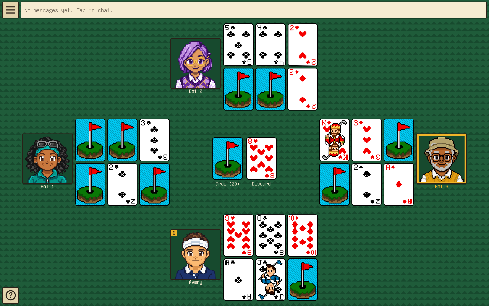

# Golf Card Game

Six Card Golf is a card game where every player lays out six cards, flips and swaps them to build the lowest score they can, and the lowest total over several holes wins. This is a free, open source way to play it in the browser with friends. One person hosts a room and shares a five-letter code, everyone picks a name and an avatar, and you play together in real time. If you don't have friends handy, fill the empty seats with bots.



**[Play Game](https://cardgolf.party)** · **[How To Play](GAMERULES.md)**

## Project overview

A TypeScript pnpm monorepo with three main packages:

| Package | What it does |
| --- | --- |
| [`packages/shared`](packages/shared/README.md) | The game engine and the messages between client and server. Pure code with no networking or UI. |
| [`packages/server`](packages/server/README.md) | A Colyseus server that runs the lobby, chat, bots and the game, and decides everything. |
| [`packages/client`](packages/client/README.md) | The React app that draws the table and sends the player's moves. |

A fourth package, `packages/infra`, defines the AWS deployment. The server owns the game, and a player only ever receives the cards they are allowed to see. [ARCHITECTURE.md](ARCHITECTURE.md) explains how the pieces fit together and why.

## Detailed tech stack

| Area | Technology | Purpose |
| --- | --- | --- |
| Language | TypeScript | Main application language across the project |
| Package manager | pnpm | Monorepo dependency and script management |
| Frontend | React 19 | UI framework |
| Build tooling | Vite | Local development server and production bundling |
| State management | Zustand | Client-side game state |
| UI animation | Motion | Transition and animation effects |
| Multiplayer server | Colyseus | Room-based matchmaking and state sync |
| Server runtime | Node.js | Game server runtime |
| Validation | Zod | Runtime schema validation for messages and state |
| Testing | Vitest | Unit and package-level tests |
| E2E testing | Playwright | Browser automation and full-flow validation |
| Linting | ESLint | Code quality checks |
| Formatting | Prettier | Consistent code style |
| CI | GitHub Actions | Automated validation on pull requests, and before every deploy |
| Hosting | AWS (S3, CloudFront, EC2), Cloudflare DNS | Static client and one game server; see [DEPLOY.md](DEPLOY.md) |
| Infrastructure | AWS CDK | The AWS resources, written in TypeScript |

## Development workflow

### Prerequisites

- Node.js 22+ (see `.nvmrc`)
- pnpm 12+

### Install dependencies

```bash
pnpm install
```

### Start the project

```bash
pnpm dev
```

This launches the client and server packages in parallel via the root workspace script. The client is at <http://localhost:5173> and the server at `ws://localhost:2567`.

### Production build

```bash
pnpm build
```

### Validation

```bash
pnpm typecheck
pnpm test
pnpm lint
pnpm format:check
```

The end-to-end test plays a whole game in two browsers. Install the browser once with `pnpm exec playwright install chromium`, then run:

```bash
pnpm test:e2e
```

CI runs all of the above on every pull request.

## Deployment

Every push to `main` runs the checks and deploys the client to S3 and CloudFront and the server to an EC2 instance. The one-time AWS setup and day-to-day operations are in [DEPLOY.md](DEPLOY.md).

## Roadmap

- **Public and private lobbies.** The server already marks each room public or private, but the client has no way to choose one and no list of open rooms to browse yet.

## License

[GPL-3.0-or-later](LICENSE)
